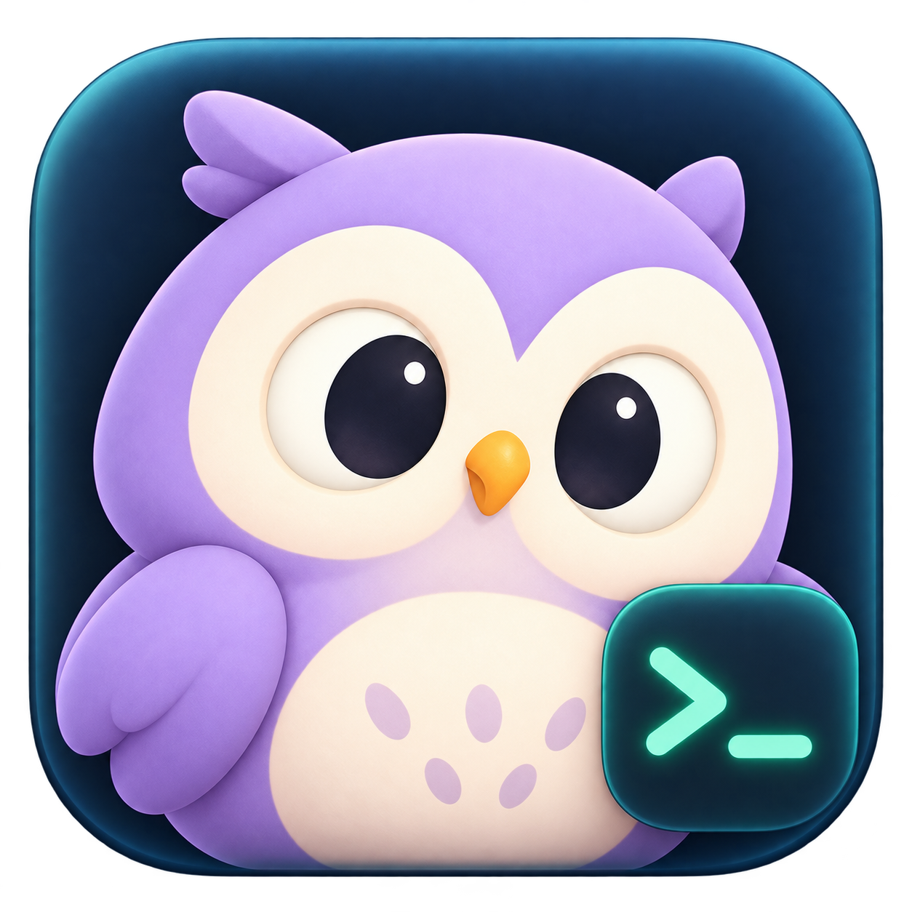

# luluTerminal



Ghostty 기반 macOS 인프라 터미널이다. 약 10대의 Linux 서버 자원을 한 화면에서 확인하고, SSH 계정별 tmux 작업을 다시 연다.
현재 Mac은 목록 맨 위에 항상 표시한다. 처음 실행하면 로컬 Mac의 기본 셸 탭을 바로 사용할 수 있으며 기존 원격 서버 선택과 저장된 탭은 유지한다. 올루루 부엉이 아이콘을 사용하며 라이트·다크 외관을 선택할 수 있다. 실행 가능한 초기 macOS 버전이며, 검사 방법과 지원 범위는 [검증 안내](docs/VERIFICATION.md)를 따른다.

## 소개 사이트

[공개 소개 사이트](https://luluterminal.cy-choi-lulu.chatgpt.site)에서 기능과 가상 제품 데모를 볼 수 있다. 소개 소스는 [`site/`](site/)에 있으며 서버 선택, 패널 접기·드래그, 라이트·다크를 브라우저에서 체험할 수 있다. 데모는 실제 서버에 연결하거나 명령을 실행하지 않는다.

## 실행과 개발

macOS 14+, Swift 6.2 이상이 필요하다. 검증 환경은 macOS 27.0.1 arm64, Swift 6.4 Command Line Tools다.
첫 빌드는 GitHub에서 고정된 Ghostty XCFramework를 받으므로 네트워크가 필요하다. 엔진에는 arm64/x86_64 슬라이스가 있으며, 실제 실행 검증은 arm64에서 수행했다.

```bash
bash scripts/test.sh
bash scripts/build-app.sh
open 'dist/Infra Terminal.app'
```

가상 서버 10대와 실제 로컬 Mac을 구분해서 보는 데모는 `open -n 'dist/Infra Terminal.app' --args --demo`로 실행한다. 데모는 SSH를 실행하거나 실사용 저장 파일을 변경하지 않는다.
로컬 Ghostty 셸 검증은 `open -n 'dist/Infra Terminal.app' --args --local-terminal`로 실행한다.
핵심 타깃만 검사하려면 `INFRA_CORE_ONLY=1 bash scripts/test.sh --scratch-path .build-core`를 사용한다.

검사 스크립트는 현재 CLT의 Swift Testing 프레임워크·매크로 플러그인 경로를 설정한다. 증분 빌드에서 플러그인이 누락되는 문제를 피하려고 폐기 예정인 native SwiftPM 빌드 모드를 사용한다. 향후 툴체인에서 기본 빌드 모드로 전환하는 검증이 필요하다.

## 사용

- 상단의 **설정** 버튼 또는 **⌘,**로 독립 설정 창을 연다. **외관** 탭에서 라이트·다크를 선택하고 각 모드의 배경·글자·포인트 색을 조절한다. 기본 팔레트는 화이트·차콜과 딥 틸이며 첫 기본값은 라이트다. 현재 모드의 색상만 기본값으로 복원할 수 있다.
- **글꼴** 탭에서 설치된 고정폭 폰트와 터미널 글자 크기(10–28pt)를 고른다. 색상·폰트는 미리보기와 열린 터미널에 즉시 적용되며 앱을 다시 열어도 유지된다. 기존 셸·연결·출력은 유지한다. 크기를 바꾸면 탭별 확대·축소를 새 설정 크기로 맞추며, 색만 바꿀 때는 확대 상태를 유지한다. **보기 · 모니터링** 탭에서 보기 모드, 자원 표시, GPU 동심원/막대, 수집 켜기와 2·5·10초 갱신 간격을 바꾼다. **일반** 탭에서 엔진·인증·저장 위치와 오픈소스 라이선스 원문을 확인한다.
- **이 Mac**은 현재 로그인 이름과 로그인 셸을 사용한다. 로컬 탭을 선택하면 홈 디렉터리에서 셸을 시작하며 SSH를 실행하지 않는다. 로컬 항목은 일반 서버 편집으로 변경하거나 제거할 수 없다.
- 로컬 탭은 전환할 때 기존 화면·셸을 유지하고 새 탭·닫기·다시 열기를 지원한다. 탭을 닫거나 앱을 종료한 뒤 다시 열면 새 셸을 시작하며 로컬 작업 지속을 보장하지 않는다.
- 로컬 CPU·RAM·디스크는 macOS API로 수집한다. RAM은 active+inactive+wired+compressed 페이지 기준으로 회수 가능한 캐시를 포함하며 Activity Monitor와 계산 기준이 다르다. 디스크는 시스템에 보이는 로컬 마운트의 캐시 통계를 사용한다. APFS 공유 용량을 합산하지 않으며 네트워크 볼륨을 직접 조회하지 않는다. 로컬 GPU·VRAM·네트워크 수집은 미지원이다.
- 서버 이름, 호스트 또는 SSH 별칭, 포트, 로그인 계정과 모니터링 계정을 등록한다. 계정마다 **SSH 키·기존 설정** 또는 **저장한 비밀번호**를 선택한다. 비밀번호는 macOS 키체인에 보관하고 터미널 연결과 모니터링에 함께 사용한다. 편집창의 빈 비밀번호 입력은 기존 값을 유지하며 삭제는 별도 버튼으로 한다. 한글 입력 모드이거나 입력한 비밀번호에 한글이 있으면 안내를 표시한다. 입력기와 문자를 자동으로 바꾸지 않으며 저장을 막지 않는다. 개인 키는 앱에 복사하지 않는다.
- 양쪽 패널 경계의 `<`·`>` 버튼으로 서버 목록과 자원을 각각 접고 펼친다. 경계를 드래그해 너비를 조절하며 끝까지 밀면 접힌다. 마지막 펼친 너비와 표시 상태는 저장되고 터미널 표면은 유지된다. 상단의 설정 버튼은 항상 표시한다.
- 서버 목록은 날개 없는 부엉이로 터미널 실행 상태를 표시한다. 눈 뜸은 터미널 프로세스가 열려 있다는 뜻이며 SSH 인증 완료를 별도로 보증하지 않는다. 자원은 오른쪽 패널에 모으고 CPU·메모리·네트워크를 같은 행에 표시한다. GPU는 바깥 틸 사용률·안쪽 연두 VRAM의 붙은 동심원과 가운데 사용률 숫자를 표시한다. 여러 디스크는 남은 용량·개별 막대·10% 이하 주의 표시로 구분한다. 미수집은 `—`로 표시하고 기존 기록·수집 상세도 우측에서 연다.
- 새 탭은 그 탭 전용 tmux 세션을 만든다. 탭에는 계정과 작업 이름을 표시하며, 서버별 선택 탭과 탭 순서·닫힌 기록을 저장한다.
- 기존 탭의 재접속은 기존 세션만 연다. 비대화형 사전 확인이 실패하면 **터미널에서 인증하고 연결**을 선택할 수 있다. 처음 호스트키를 확인하거나 추가 인증이 필요한 경우 실제 SSH 터미널에서 처리한다. 저장한 비밀번호의 자동 인증은 확인된 호스트키와 일반 password 인증을 사용하며 경유 SSH·OTP·HostKeyAlias는 수동/키 인증을 사용한다.
- 원격 세션이 없으면 자동으로 다시 만들지 않는다. 사용자가 **새 세션 만들기**를 선택해야 생성하며, 같은 세션이 이미 있으면 생성을 중단한다.
- 탭 닫기·연결 해제는 로컬 연결만 닫는다. 원격 tmux 작업은 유지한다. 서버 재부팅이나 원격 프로세스 종료 후에는 작업 복원을 보장하지 않는다.
- 모니터링은 SSH 키 또는 저장한 비밀번호 인증과 Linux `/proc`, `df`를 사용한다. NVIDIA GPU는 선택적으로 `nvidia-smi`의 UUID·index와 사용률·VRAM을 읽는다. Linux 디스크는 pseudo 파일시스템을 제외한 마운트를 개별 수집하고 합산하지 않는다. 목표 주기는 선택 서버 기본 2초(설정에서 2·5·10초), 나머지 10초이며 동시 수집 상한은 3대다. 오른쪽 사용량 막대·GPU 동심원과 주요 수치는 측정값 변경 시 0.45초 동안 부드럽게 전환하며, macOS 동작 줄이기 설정을 따른다. 느린 응답에서는 실제 주기가 길어질 수 있다. 저장한 비밀번호로 SSH 연결 확인이 실패하면 해당 계정의 자동 시도를 멈추고 명시적인 재시도 또는 자격 증명 수정 후 다시 시작한다.
- 지표 이력은 앱 실행 중 최근 15분만 표시한다. 앱을 다시 실행하거나 긴 공백이 생기면 이력을 이어 붙이지 않는다. Ansible은 비활성 예정 메뉴다.

상태 파일은 `~/Library/Application Support/InfraTerminal/workspace-v1.json`에 저장한다. 연결 종류가 없는 기존 v1 프로필은 SSH로, 인증 방식이 없는 계정은 기존 SSH 키·설정 방식으로 읽는다. 비밀번호 원문은 상태 JSON에 넣지 않는다. 손상 파일을 기본값으로 덮어쓰지 않으며 오류와 복구 경로를 표시한다. 기존 SSH 탭이 사용하는 계정 이름은 변경할 수 없으므로 다른 사용자는 새 계정으로 추가한다.

동작 계약은 [SPEC](docs/SPEC.md), 작업 간 API는 [INTERFACES](docs/INTERFACES.md), 엔진 출처·라이선스는 [THIRD_PARTY](docs/THIRD_PARTY.md)에 기록했다.
한국어 IME 조합 입력, VoiceOver, 네트워크 장애·장시간 수집은 추가 수락 검증 대상이다. 빌드한 앱은 ad-hoc 서명이며 Developer ID 서명·공증·자동 업데이트를 제공하지 않는다. 저장 데이터와 기존 앱 호환성을 위해 내부 실행파일·bundle 식별자·빌드 결과 경로는 InfraTerminal 이름을 유지한다.

## 보안과 라이선스

개인 키·비밀번호 원문과 실사용 서버 프로필은 저장소에 포함하지 않는다. 기존 키 인증은 사용자의 OpenSSH 설정을 따른다. 저장 비밀번호는 서버·계정·연결 대상에 묶이며 호스트·포트·로그인 이름이나 SSH 별칭의 실제 대상이 바뀌면 다시 저장해야 한다. ad-hoc 서명된 앱을 갱신하면 macOS에서 키체인 접근을 다시 확인할 수 있다. 설정된 원격 서버와 로컬 셸은 해당 사용자 권한으로 동작하므로 신뢰하는 대상만 연결한다. [보안 범위](SECURITY.md)를 참고한다.

앱 코드와 올루루 자산에는 아직 별도 재사용 라이선스를 지정하지 않았다. Ghostty 및 함께 배포하는 라이브러리·폰트의 라이선스와 원문 고지는 [THIRD_PARTY](docs/THIRD_PARTY.md)에 정리하며 빌드한 앱에도 포함한다.
