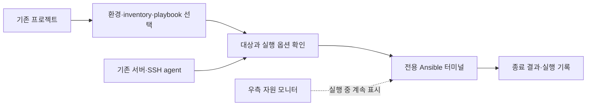

# luluTerminal Ansible 연동 설계안 (취소된 제안)

작성: 2026-10-23. 상태: **사용자 결정으로 개발 취소, 미구현**.

2026-10-23 사용자는 Ansible 기능을 포기하고 기존 터미널·서버 연결·자원 모니터링에 집중하기로 결정했다. 아래 내용은 결정 이전의 설계 이력으로만 보존한다. 단계별 구현·호환 spike·실서버 실행은 진행하지 않으며 현행 로드맵이 아니다.

원래 설계 요청: 사용자는 앱 안에서 Ansible을 연동하는 방향의 설계를 요청했다. 이 문서 작성은 의존성 설치·플레이북 실행·실서버 변경 승인이 아니다. 현재 앱의 Ansible 메뉴·설정은 비활성이며 실행기는 없다.

## 제안과 사용자 흐름

첫 버전은 **기존 Ansible 프로젝트를 연결하고 앱의 전용 터미널에서 실행하는 기능**에 집중한다. 기존 inventory·그룹·roles·변수·SSH 설정을 유지한다. 프로젝트를 새 형식으로 변환하거나 플레이북 편집기를 먼저 만들지 않는다.

| 화면 | 사용자가 하는 일 | 앱의 역할 |
| --- | --- | --- |
| 프로젝트 | 로컬 프로젝트 폴더, 실행 환경, inventory, playbook 선택 | .yml/.yaml 모두 탐색. roles의 task 파일을 실행 가능한 playbook으로 단정하지 않고 사용자가 진입점을 선택. 설정·의존성·경로 확인 |
| 대상 | inventory hostname을 골라 앱 서버에 연결 | UUID 매핑을 명시적으로 저장. 표시 별칭·주소가 비슷하다는 이유로 자동 매핑하지 않음. 기존 그룹을 유지하면서 limit 적용 |
| 실행 전 | 대상·태그·권한 상승·검사/실행 방식 확인 | syntax·대상 목록·task/tag 목록을 별도 확인. 프로젝트 파일이나 선택이 바뀌면 이전 확인 무효화 |
| 실행 | 전용 터미널에서 sudo·Vault·pause 응답 | 기존 SSH/tmux 탭과 분리한 실행 UUID, 실제 종료 코드·중지·경과 시간 관리 |
| 결과 | 성공/실패/중지·실행 기록 확인 | 첫 버전은 작업 단위 결과와 실제 터미널 출력. 이후 서버·task별 구조화 결과 추가 |

기존 왼쪽 서버 목록과 오른쪽 자원 패널은 유지한다. 중앙 작업 영역에서 터미널/Ansible을 전환하고 기존 비활성 Ansible 진입점을 사용한다. 상단 바를 한 줄 더 만들거나 자원 패널에 실행 설정을 몰아넣지 않는다. 실행 중 다른 서버를 봐도 작업은 유지하며, 작업 닫기는 중지 또는 보기만 숨기기를 명시적으로 구분한다. 앱 종료 시에는 실행 중 작업을 중지하고 종료하거나 앱 종료를 취소한다. 앱을 닫은 뒤 계속 실행하는 모드는 첫 버전 범위 밖이다.

## 구조 선택

| 접근 | 장점 | 비용·판단 |
| --- | --- | --- |
| CLI + 전용 PTY + native supervisor | 기존 입력 흐름·프로젝트 설정을 그대로 사용. Python 앱 연동 계층 추가 없음 | 종료 코드·cwd·취소 계약은 새로 필요. **1단계 권장** |
| ansible-runner + Python helper | task/host 이벤트·status/cancel callback 제공 | runtime 버전·대화형 입력·artifact·출력 크기 관리 필요. **2단계 검토** |
| 원격 컨트롤러/AWX | Mac을 닫아도 작업·예약·공유 운영 가능 | 별도 서비스·권한·배포·운영 필요. **장기 범위** |

첫 버전은 stdout 문구나 색상 recap을 파싱해 성공·호스트별 상태를 추측하지 않는다. 이벤트 UI가 필요해지는 단계에서 공식 Runner 인터페이스를 연결한다. Runner는 event_handler·status_handler·cancel_callback을 제공하지만 현재 앱이나 확인된 프로젝트 환경에서 실행 검증된 것은 아니다. [Runner Python 인터페이스](https://docs.ansible.com/projects/runner/en/latest/python_interface/)

## 확인된 호환 요구

기존 운영 프로젝트를 읽기 전용으로 조사했다. 공개 문서에는 실제 inventory 호스트·계정·IP·변수 원문을 복제하지 않는다.

- 상대 roles_path, group_vars, vars_files, 정적 YAML inventory와 memory fact cache를 사용한다. 원래 프로젝트 cwd와 선택한 ansible.cfg를 유지해야 한다.
- requirements.yml에 ansible.posix <2.2.0 제약이 있다. 선택한 프로젝트의 제약을 우선하며 앱이 collection을 조용히 업그레이드하지 않는다.
- become, pause, delegate_to, run_once, check_mode: false가 있다. 대화형 입력, 위임, 그룹 실행 의미를 보존해야 한다.
- 기존·검증 대기 그룹이 섞일 수 있다. 해당 운영 프로젝트의 현재 계약은 확인된 단일 hostname의 정확한 limit이며 광범위한 all/그룹 실행을 허용하지 않는다. 앱도 이 프로젝트의 첫 적용은 단일 호스트로 제한한다. 다른 프로젝트의 복수 호스트 모드는 별도 검토 대상이다.
- 확인한 PATH와 표준 Homebrew 경로에서 Ansible 실행 파일을 찾지 못했다. 다른 가상환경의 설치 유무까지 증명한 것은 아니다. 이번 작업에서 의존성을 설치하거나 Ansible 명령을 실행하지 않았다.

## 실행 환경·프로젝트

1. 프로젝트 root·config·inventory·playbook은 명시적으로 선택한 로컬 경로 참조로 저장한다. 원본 프로젝트를 복제하거나 inventory를 재생성하지 않는다.
2. 사용자가 고른 venv/Ansible 설치의 절대 실행 파일을 사용하고 core·Python·collection 버전을 확인한다. 최신 버전을 임의로 고정하지 않는다. 지원 조합은 호환 spike 후 명시하고, 환경이 없거나 조건이 맞지 않으면 실행을 비활성화한다. 첫 버전은 앱의 자동 설치·자동 업그레이드를 제공하지 않는다.
3. cwd는 원본 프로젝트 root, ANSIBLE_CONFIG는 확인된 선택 파일이다. 주변 작업의 ANSIBLE_* 값이 몰래 섞이지 않도록 실제 적용 환경을 명시적으로 구성하고 보여 준다. 프로젝트가 요구하는 환경 변수는 별도 사용자 선택 없이는 누락·상속을 단정하지 않는다.
4. project ID, 경로 참조, playbook/inventory 상대 경로, runtime 경로, host↔server UUID 매핑, 비밀 없는 옵션만 별도 버전 JSON에 저장한다. workspace-v1.json과 기존 SSH 탭을 변경하지 않는다.
5. 실행 기록은 선택한 파일·옵션·버전·Git commit/dirty 여부·선택 파일 fingerprint·시작/종료·exit/signal을 저장한다. 임의 extra vars 값·전체 환경·inventory hostvars는 기록하지 않는다. fingerprint는 전체 dependency snapshot이나 실행 재현성 보장이 아니다. 원본 파일 변경을 감지하면 실행 전에 다시 확인하며 실행 중 편집 가능성은 남는다.

Ansible은 ANSIBLE_CONFIG와 cwd 등의 순서로 설정을 찾으며 connection 변수는 CLI 기본값보다 우선할 수 있다. 앱은 명령 문자열만으로 실제 설정을 설명해서는 안 된다. [설정·변수 우선순위](https://docs.ansible.com/projects/ansible/latest/reference_appendices/general_precedence.html)

## SSH 키·비밀번호·대상 매핑

**첫 버전의 인증은 기존 Ansible 프로젝트 설정이 소유한다.** 앱 서버 매핑은 표시·자원 모니터 연결이며, 앱에서 고른 계정이 Ansible의 모든 task에 강제 적용된다는 뜻이 아니다.

- 기존 ssh-agent를 재사용할 수 있다. 앱 생성 키가 잠겨 있으면 기존 잠금 해제 UI를 먼저 연다. 신뢰한 프로젝트에만 같은 SSH_AUTH_SOCK을 전달한다. 해당 agent의 다른 identity도 사용 가능하므로 계정별 격리라고 표시하지 않는다.
- 앱 생성 키를 쓰려면 해당 inventory host의 프로젝트 소유 SSH 설정이 기존 키 경로를 명시적으로 참조해야 한다. UI는 키 경로 참조 안내와 대상 비교를 제공하되 개인 키 내용을 복사·export하거나 inventory를 자동 수정하지 않는다. 최초 프로젝트 설정은 필요하지만 이후 선택을 재사용한다.
- 앱 Keychain 도우미와 저장 비밀번호를 Ansible에 연결하지 않는다. 키 암호·sudo·Vault 암호를 argv, extra vars, 환경, 상태 파일·실행 기록에 넣지 않는다. 키 암호는 실행 전 agent 잠금 해제, sudo/Vault와 pause는 전용 PTY에서 직접 입력한다. 기존 프로젝트의 임의 로컬 코드까지 Keychain 접근을 통제하는 sandbox라고 주장하지 않는다.
- 전역 -u/--private-key는 강제 바인딩 수단으로 쓰지 않는다. 반대로 전역 extra vars로 user/key를 강제하면 위임·localhost 작업까지 영향을 줄 수 있으므로 사용하지 않는다.
- 호스트키 확인을 유지한다. 기존 ProxyJump·HostKeyAlias·connection plugin을 현재 앱 managedKey의 직결 정책으로 덮어쓰지 않는다. 입력 SSH 별칭이 같아도 실제 대상이 다르면 매핑 재확인이 필요하다.

OpenSSH 연결에서 암호 있는 키는 실행 전에 agent에 준비해야 한다. 작업의 대화형 pause는 실제 터미널 입력을 요구한다. [SSH connection plugin](https://docs.ansible.com/projects/ansible/latest/collections/ansible/builtin/ssh_connection.html), [pause](https://docs.ansible.com/projects/ansible/latest/collections/ansible/builtin/pause_module.html)

2단계의 자동 계정 연동은 inventory alias→앱 key reference를 매핑하고 host/user/port와 연결 방식·위임·키 변수 충돌을 검증하는 별도 adapter다. 임의 playbook은 task 실행 시 연결 변수를 바꾸거나 로컬 SSH를 직접 호출할 수 있다. 따라서 제한된 지원 조합을 정하고 충돌을 거부하는 방향으로 설계해야 하며 단순 inventory 조회만으로 강제 격리를 보장하지 않는다. 이 adapter는 첫 버전의 완료 조건이 아니다.

## 사전 확인과 실행 의미

- syntax 검사, list-hosts/list-tasks/list-tags는 실제 Ansible 환경으로 프로젝트를 평가한다. inventory·lookup·plugin은 로컬 코드를 실행하거나 외부에 접근할 수 있어 신뢰한 프로젝트에만 허용한다. 태그가 없으면 전체 작업으로 표시한다.
- limit은 원본 inventory의 선택 범위를 줄이며 새로운 단일 호스트 inventory로 변환하지 않는다. playbook의 group/run_once/serial 의미를 유지한다. host pattern 특수문자를 그대로 결합하지 않고 정확한 hostname 목록으로 검증한다. 선택 결과가 비었거나 예상과 다르면 실행을 차단한다.
- **--limit은 보안 격리가 아니다.** delegate_to/local_action/connection: local은 선택 밖 호스트나 Mac에서 실행할 수 있다. 위임 정보가 동적으로 계산돼 확정되지 않으면 미확인이라고 표시한다. [위임 의미](https://docs.ansible.com/projects/ansible/latest/playbook_guide/playbooks_delegation.html)
- 검사 버튼은 **예상 변경 확인(--check)**으로 표시하고 실제 실행과 구분한다. 미지원 모듈은 생략될 수 있고 check_mode: false는 실제 변경을 할 수 있으므로 무변경 보장이라고 표시하지 않는다. diff는 기본 꺼짐이며 비밀 내용이 보일 수 있음을 선택 시 안내한다. [check/diff 동작](https://docs.ansible.com/projects/ansible/latest/playbook_guide/playbooks_checkmode.html)
- 실제 실행 직전 프로젝트·playbook·inventory·정확한 대상 수·계정 설정 출처·become·check/diff·태그를 확인한다. 비밀번호와 임의 비밀 변수는 이 요약에 넣지 않는다. [CLI 옵션](https://docs.ansible.com/projects/ansible/latest/cli/ansible-playbook.html)

## 프로세스·상태·입력

현재 ProcessRunner는 기본 8초/1 MiB의 짧은 수집 명령용이며 cwd·streaming·PTY 입력 계약이 없다. TerminalHost.onExit(UUID)는 실제 종료 코드가 아니다. 둘 중 하나를 그대로 Ansible 완료 API로 사용하지 않는다.

새 AnsibleJobSupervisor는 기존 Ghostty의 전용 PTY 안에서 실행한다. cwd와 인자 배열을 적용하고 Ansible을 시작한 뒤 실제 waitpid의 exit/signal을 작업 전용 제어 채널로 앱에 전달한다. PTY 텍스트와 제어 결과를 구분하며 임의 terminal output을 상태 명령으로 해석하지 않는다. job UUID·generation을 검증하고 오래된 결과가 재실행을 덮지 못하게 한다. 제어 채널은 사용자 전용 경로/권한과 크기 제한을 갖는다.

상태는 준비/확인 필요/실행 중/중지 중/성공/실패/중지/중단됨으로 구분한다. 시작 실패는 오류이고 성공은 정상 exit 0을 관찰한 경우에만 표시한다. 결과가 없거나 app/helper 연결이 끊기면 중단됨으로 남기며 자동 재실행하지 않는다. 비정상 종료 코드·signal은 그대로 기록한다. 동적 task 수를 모르므로 가짜 완료 백분율을 표시하지 않는다.

취소는 작업 전용 프로세스 그룹에 정상 중단 신호를 보내고 제한 시간 뒤 남은 로컬 자식만 종료·회수한다. 원격 async 작업 종료나 이미 반영한 변경의 rollback은 보장하지 않는다. 자동 재시도는 없다. 조용한 작업이나 입력 대기를 무조건 timeout으로 끊지 않고, 장시간 실행 제한은 별도 명시 옵션으로 둔다.

## 자원·로그 상한 제안

아래 수치는 구현·측정 전의 제품 예산이다. 현재 앱이 이미 이 조건을 충족한다고 주장하지 않는다.

| 자원 | 1단계 제안 | 상한 도달 동작 |
| --- | --- | --- |
| 실행 | 앱 전체 동시 작업 1개, forks 기본 3 / 선택 1–10 | 추가 실행은 대기 확인, 무제한 background task 생성 금지 |
| 터미널 | 작업 scrollback 8 MiB 목표 | 엔진에서 byte 상한 적용 가능 여부를 spike로 검증. 종료된 작업 surface는 해제. 출력 전체를 Swift String에 추가 보관하지 않음 |
| 상태 | 작업 metadata 64 KiB, 목록은 페이지당 100개 | 큰 오류·환경·전체 inventory를 결과 JSON에 넣지 않음 |
| 기록 | 원문 stdout/diff/facts/비밀 변수의 자동 영구 저장 없음. metadata 총 100 MiB | 기존 기록을 자동 삭제하지 않고 새 실행 전 사용자가 내보내기·정리를 선택하도록 안내 |

실행 기록에 다시 볼 수 있는 원문 로그가 항상 있는 것은 아니다. 필요할 때 사용자가 명시적으로 내보내며 로그에 비밀이 없다고 보장하지 않는다. no_log를 존중하더라도 임의 task 이름·debug 출력의 비밀을 완전 자동 삭제할 수는 없다.

2단계 Runner는 UI queue뿐 아니라 원래 stdout·job_events·fact cache·artifact 파일까지 제한해야 한다. 예산 후보는 최근 2,000개/4 MiB 이벤트, 단일 이벤트 256 KiB, 실행별 디스크 100 MiB다. 초과는 상태/종료 결과와 상세 로그 잘림을 분리하고 원본 artifact의 계속 증가를 허용하지 않는다. 사용 버전에서 저장 억제/streaming이 가능한지 먼저 검증하며, 안 되면 실행 취소 정책을 명시해야 한다. 메모리 배열 하나를 제한했다고 전체 저장이 제한됐다고 보지 않는다. Runner의 private-data 입력에는 key·password 파일도 포함될 수 있으므로 기본 디렉터리 구조를 그대로 비밀 저장소로 사용하지 않는다. [Runner 입력·artifact 구조](https://docs.ansible.com/projects/runner/en/latest/intro/)

## 수락 검사 계획

**아직 구현·실행하지 않은 검사다.** 현재 128개 앱 검사와 구분한다. 처음에는 임시 프로젝트·fake executable·로컬 fixture로 확인하며 실서버는 별도 승인된 단일 대상에서만 수락한다.

| ID | 필수 검사 | 통과 조건 |
| --- | --- | --- |
| ANS-01 | 원본 프로젝트·cwd·config·inventory·그룹·.yml/.yaml | 경로/공백 인용 안전, group_vars/roles/vars_files 의미 보존, 원본 무수정 |
| ANS-02 | 선택·특수문자·stale plan·빈 대상 | 정확한 limit, 선택 변경 후 재확인, 옵션/셸 주입 없음 |
| ANS-03 | 계정·key·agent·위임·local 연결 | CLI보다 우선하는 변수를 거짓으로 덮지 않음, 전역 계정 주입 없음, Keychain 도우미·개인 키 복사 없음 |
| ANS-04 | PTY에서 sudo/Vault/pause | 실제 입력·취소 가능, 비밀이 argv/env/metadata에 없음, 잠긴 키는 사전 unlock |
| ANS-05 | 종료 0/비0/signal/launch 실패/제어 채널 상실 | 실제 상태 구분, terminal 닫힘만으로 성공 처리 안 함, stale 결과 차단 |
| ANS-06 | 취소·앱 종료·자식/손자·출력 폭주 | 작업만 종료·회수, 기존 SSH/tmux/수집 보존, 지정 버퍼 상한, 반복 RSS/FD/프로세스 관찰 |
| ANS-07 | check_mode:false·delegate/local·no_log·diff | 검사/limit 한계 표시, 비밀 원문 기본 미저장, 원격 변경은 승인된 disposable 대상에서만 검증 |
| ANS-08 | 설치 환경 없음·버전/collection 불일치 | 정확한 이유로 실행 비활성화, 자동 설치/업그레이드 없음 |
| ANS-09 | 이후 Runner adapter | event 순서·중복·부분 recap·unreachable/rescued/ignored·취소·artifact 폭주를 검증한 뒤 호스트별 결과 UI 허용 |

## 구현 순서와 다음 결정

1. **호환 spike**: 임시 localhost 프로젝트로 현재 Mac의 명시적 runtime 조합, PTY 입력, 실제 종료/중지, cwd, scrollback 상한을 확인한다. 외부 서버를 건드리지 않는다. 의존성 설치는 별도 구현 범위로 정한다.
2. **첫 제품 버전**: 프로젝트·단일 대상·전용 실행 터미널·실제 작업 결과·metadata 기록. ANS-01…08을 통과하고 승인된 서버에서 기존 터미널·자원과 함께 수락한다.
3. **다음 버전**: Runner 호스트/task별 결과, 검증된 앱 계정 adapter, 검토된 복수 호스트 실행, 자주 쓰는 실행 옵션 프리셋. 매번 같은 설정을 고르는 부담을 줄이되 YAML 원본은 유지한다.
4. **장기**: Mac 종료 후 지속 실행·예약·팀 공유가 필요할 때 원격 컨트롤러를 검토한다.

권장 우선순위는 기존 플레이북 실행이다. 자주 쓰는 작업 버튼은 검증된 프로젝트·playbook·옵션을 저장하는 프리셋으로 확장한다. 이 제안에 대한 사용자 피드백과 호환 spike 결과를 현행 SPEC에 반영한 뒤 제품 구현을 시작한다.
